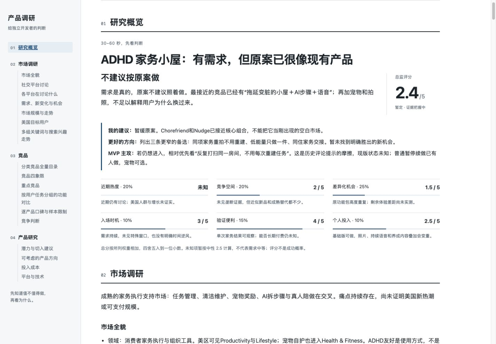
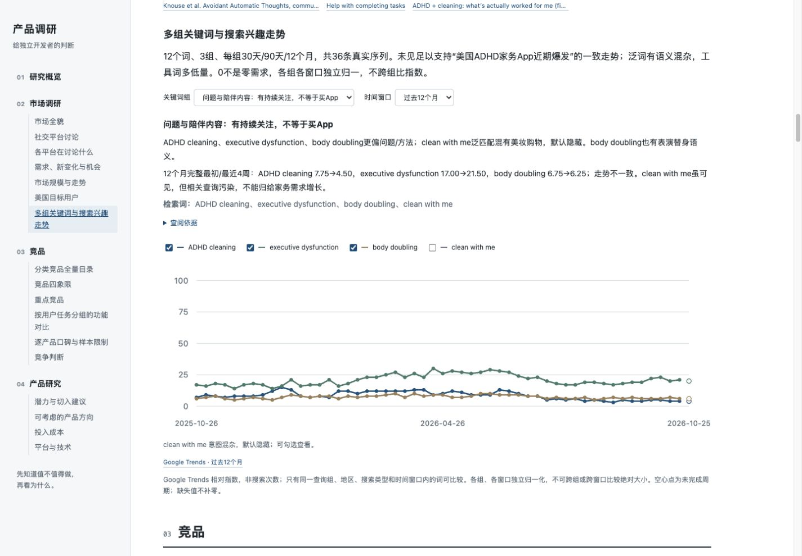
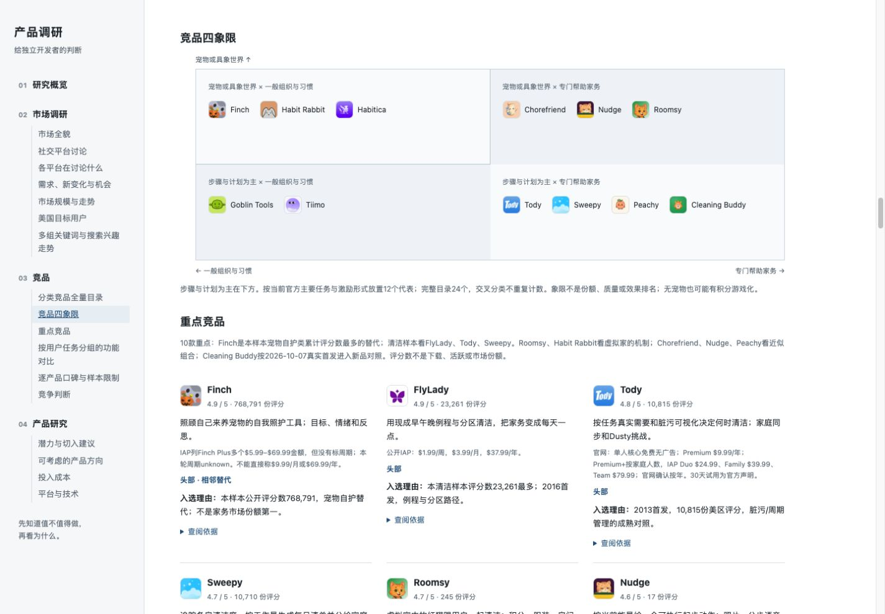

# product-idea-research

**给独立开发者的产品调研 Skill：这个 idea 值不值得做，真要做，该从哪里切入？**

把一句想法或你已经整理的 research 交给 AI Agent。它会研究美国市场里的社交讨论、搜索趋势和竞品，最后给出判断、5分制评分，以及比原案更值得考虑的方向。

输出一份可以直接阅读的交互式 HTML，同时提供 Markdown 和研究数据。概览争取 30–60 秒读完，五分钟抓住主线；想深入时，再展开来源与细节。

`v0.6.0` · 标准 Agent Skills 目录 · Codex / Claude Code / 其他兼容编码 Agent

## 先看报告长什么样

下面是实际完成的 **「ADHD 友好家务小屋」** 调研截图，保留原报告的结论与未知项。它展示的是报告能力，不是推荐你照做这个产品。截图为 2026-10-28 快照，市场数据会变化。

### 先给判断，而不是一堆材料

原案行不行、为什么、有没有更好的方向、MVP 应该主攻什么；总分和六项短理由放在一起，概览不塞引用链接。



### 看真实搜索趋势，区分话题热和产品需求

多组关键词、美国地区、30天 / 90天 / 12个月；可切换组、窗口和关键词。没有原始数据就不画虚构曲线，不跨查询组比较归一化指数。



### 竞品有分类，也有逐家的分析

先看四象限和分类目录，再看头部、最相似与近期新品。功能按用户任务分组对比；好评、差评、评分和文字样本限制逐家呈现。



截图原始文件与校验信息见 [示例记录](assets/examples/manifest.json)。另有 [合成阅读演示](examples/reading-demo/report.html) 可下载后在浏览器打开，专门展示结构和交互，不是市场证据。

## 安装

### 用 Skills CLI 安装

需要 Git，以及满足 [Skills CLI 当前要求](https://github.com/vercel-labs/skills) 的 Node.js（本次验证使用 CLI 1.7.4，要求 Node.js 22.20.0+）。命令明确指定 Agent，不会让安装器自动选择其他工具。

**Codex**

```bash
npx skills add 1085995907ljh-hash/product-idea-research --skill product-idea-research -g -a codex --copy
```

**Claude Code**

```bash
npx skills add 1085995907ljh-hash/product-idea-research --skill product-idea-research -g -a claude-code --copy
```

**同时安装到 Codex 和 Claude Code**

```bash
npx skills add 1085995907ljh-hash/product-idea-research --skill product-idea-research -g -a codex -a claude-code --copy
```

`-g` 是个人全局安装；删掉它则安装到当前项目。已有同名 Skill 时，先保留自己的修改再更新。安装后按宿主要求重新加载 Skill，或打开新会话。

其他支持 Agent Skills 的编码 Agent 也可使用本包。安装器当前支持的名称与目录见 [官方 Agent 列表](https://github.com/vercel-labs/skills/blob/main/docs/agents.md)，例如 `cursor`、`gemini-cli`、`opencode`、`github-copilot`；将 `-a` 后面的名称换成你的宿主即可。**这些宿主尚未逐一完成完整调研实测**，工具权限和子代理能力也可能不同。

### 手动安装 / ZIP

不使用 Node.js 也可以安装：

1. 下载 [完整目录 ZIP](dist/product-idea-research-v0.6.0.zip)，解压出 `product-idea-research/`。
2. 将**整个目录**放入宿主的 Skill 目录，不能只复制 `SKILL.md`。
3. 重新加载，在对话中调用。

Claude Code 的个人目录是 `~/.claude/skills/`；当前 Skills CLI 为 Codex 使用 `~/.agents/skills/`。手动安装以宿主文档为准，避免在多个可发现目录重复安装同名 Skill。

如果你的宿主明确支持「根级 SKILL.md」ZIP 导入，使用 [Flat ZIP](dist/product-idea-research-v0.6.0-flat.zip)。两个包的内容相同，只是目录层级不同；校验值见 [SHA256SUMS](dist/SHA256SUMS)。不是所有聊天产品都支持上传 Skill ZIP，安装成功也不等于获得联网、浏览器或子代理权限。

## 运行前需要什么

| 需要 | 用途 |
| --- | --- |
| 支持 Agent Skills 的编码 Agent | 理解想法、调度研究、形成判断 |
| Python 3.10+ | 预检、结构校验、生成 HTML / MD / ZIP；仅用标准库，无 pip 依赖 |
| 文件、Shell 与公开联网工具 | 保存资料、运行脚本、核查来源 |
| 另行安装的 [Agent Reach](https://github.com/Panniantong/Agent-Reach) Skill、CLI 与可用后端 | 读取其当前指引，检查并使用实际可访问的渠道 |

有独立子代理能力时，会使用隔离上下文；没有则明确披露并顺序执行角色工作单。浏览器用于动态网页和报告视觉检查，没有浏览器就不会声称完成这些检查。Yao Meta Skill 是作者维护工具，**使用本包不需要安装 Yao**。

Skill 不附账号、Cookie 或第三方服务授权，不会自动修改权限。某个平台被阻挡时，报告如实注明覆盖限制，不会把「查不到」写成「没人需要」。

## 怎么用

**Codex**

```text
使用 $product-idea-research，研究这个想法：
像电子宠物一样的 ADHD 友好家务 App，房子会随拖延变脏。
打扫后恢复干净，支持语音一步步陪做，也能拍房间照片生成家务。
我一个人用 AI 开发，希望判断美国市场值不值得进入。
```

**Claude Code**

```text
/product-idea-research 研究一个面向美国用户的 AI 护肤记录 App：
每天自拍，结合护肤与生活习惯记录，查看自己的皮肤变化。
请判断现有产品已经满足了什么，还有哪些更适合独立开发者的切入点。
```

已有 research 也可以直接给：

```text
用 product-idea-research 深入核验下面的 idea 和已有研究。
请区分我提供的假设和已核实事实；补齐社交讨论、多关键词趋势、
头部/相似/新竞品及逐家口碑，最后给进入建议和更好的方向。
[粘贴 idea、链接或文档]
```

默认研究美国消费者市场，中文报告、美元计价；平台按 idea 判断。能合理推断的事情直接研究，只有关键目标冲突时才提问。你可以在对话里追问，或要求针对某个方向做下一轮深入研究。

## 你会得到什么

| 章节 | 回答的问题 |
| --- | --- |
| **研究概览** | 能不能做、建议进入/观望/不进入、六维评分、更好方向与 MVP 主攻 |
| **市场调研** | 属于什么领域、市场如何演变、谁在讨论什么、需求新旧、美国用户习惯、规模与搜索走势 |
| **竞品** | 有哪些方向的玩家、谁必须重点分析、功能差异、每款的好差评与当前竞争压力 |
| **产品研究** | 原案潜力、3–5个有区别的方向、痛点与差异、个人投入和平台/技术可实现性 |

通常列出 15–25 款分类竞品，深入分析 8–10 款；关键词通常 8–15 个，按问题、解决方案、产品词分组。资料不足就少列并说明，不为凑数补造。

六维评分：近期热度20%、竞争空间20%、具体缺口25%、入场时机10%、验证便利15%、个人投入10%。未知单项保留为空，暂定总分明确标记；评分不是成功概率。推荐方向和原案使用同一把尺，没有好方向也会直说。

| 文件 | 用途 |
| --- | --- |
| `report.html` | 可离线打开的交互报告，四章子目录、竞品图标/矩阵、趋势切换、关键来源可点击 |
| `research.md` | 可下载、编辑和继续交给 AI 的 Markdown |
| `research.json` | 结构化内容、来源和证据关系 |
| `research.zip` | 分享用 MD / JSON / 来源清单，不含 raw、work 或账号/权限状态；HTML 另行提供 |

宿主有右侧预览时会打开报告；其他环境交付本机文件。报告顶部支持下载，底部不放批准按钮，讨论继续在 AI 对话中进行。

本 Skill 到前期研究为止。它会建议 MVP 主攻点，**完整 MVP PRD 属于下一步独立工作**。

## 研究如何协作

总监先形成中性 brief，派出独立研究员：**社交需求、竞品格局、市场与平台**；再由新的 **功能与口碑** 研究员核验重点对手。总监交叉比对、处理矛盾、定向补查，最后让独立挑战者检查建议是否站得住。

研究员使用新的上下文，不带总监的预设分数或偏好；每个角色只写自己的资料目录。没有上下文隔离能力时必须说明，不能用几段角色扮演假装独立研究。

可移植的能力映射见 [宿主适配](skills/product-idea-research/references/agent-compatibility.md)，实际验证范围见 [兼容性验证记录](docs/compatibility-validation.md)。

## 维护与本地验证

```bash
python3 -m unittest discover -s skills/product-idea-research/tests -v
```

在研究数据已经填好后校验并渲染：

```bash
python3 skills/product-idea-research/scripts/report.py validate /path/to/my-research
python3 skills/product-idea-research/scripts/report.py render /path/to/my-research
```

`report.py init` 只创建骨架；研究由 Agent 取证完成，脚本不会自动产生市场结论。作者修改后暂存要打包的 Skill 源码，再运行 `python3 scripts/build_release.py`；只收录 Git 跟踪的分发资源，生成可复现的两种 ZIP 与 SHA256。旧 v1–v4 报告继续使用历史渲染契约。

目录：`skills/product-idea-research/` 为独立安装包，`assets/examples/` 为 README 截图，`examples/reading-demo/` 为合成演示。真实研究运行目录、原始社交资料、凭据和本机审计日志不入库。

参考 [iphone-ui](https://github.com/1085995907ljh-hash/iphone-ui) 的安装与多宿主分发方式；遵循 [Agent Skills 规范](https://agentskills.io/specification)。当前许可为 **UNLICENSED**，公开可见不代表已授予修改或再分发许可。
